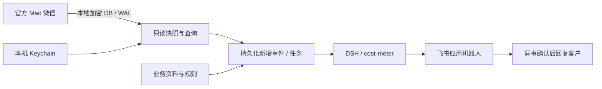

# NoteBridge

GitHub 仓库名保留 **wx-watcher**。从 WX Watcher 升级请看 [更名与数据迁移](docs/MIGRATION.md)。

**普通微信本地消息 → DSH 回复建议 → 飞书内部群。**

macOS 本地消息助手：图形配置向导、菜单栏应用、独立微信凭据工具、只读消息 API，
以及可恢复的回复建议任务。建议送达内部飞书群，由同事确认后回复客户。

[English](README.en.md) · [新机从零指南](docs/FIRST_RUN.md) · [安装](docs/INSTALL.md) · [微信取钥](docs/KEYTOOL.md) ·
[DSH](docs/DSH.md) · [飞书](docs/FEISHU.md) · [运维](docs/OPERATIONS.md) ·
[开发](docs/DEVELOPMENT.md) · [安全与隐私](SECURITY.md)

## 从哪里开始

| 目标 | 入口 |
| --- | --- |
| 第一次使用 | [新机器从取钥到运行（含界面示例）](docs/FIRST_RUN.md) |
| 已有密钥 | 应用 → 更多 → 凭据与恢复 → 手动导入 |
| 第一次取钥 | [取钥向导及恢复](docs/KEYTOOL.md) |
| 使用现有模型渠道 | [DSH 与 cost-meter](docs/DSH.md) |
| 飞书接入 | [应用、权限、机器人与联调](docs/FEISHU.md) |
| 开发其他读取工具 | [只读 API 与凭据引用](docs/API.md) |

## 使用流程

主导航只有「工作台」和「接入设置」。接入流程分步展示；业务资料、凭据维护与运行诊断收在「更多」。

1. 新机打开 NoteBridge，点击「首次连接微信」，完成逐项检查和取钥向导；已有凭据可直接验证复用。
2. 等待数据库验证、官方客户端恢复及 Keychain 保存，再点「下一步：选择会话」。后续按步骤连接模型和飞书。
3. 选择准确的微信会话，配置业务资料和回复规则。
4. 已有 DSH 模型渠道和费用插件会复用；缺少费用插件时由已安装的 Desktop 补齐。
5. 选择飞书接收群，点击「测试并开始运行」。
6. 通过菜单栏管理后台运行，可同时开启登录启动。

当前仍为开源预发布版本，真实验证范围见 [验收记录](docs/VALIDATION.md)。

首次扫描建立历史基线，后续处理新增事件。支持连续消息合并、持久化任务与调用上限。
模型失败或投递结果不确定时进入待核对状态，避免无限自动重试。

账号切换：接入设置第 1 步区分微信当前登录账号与已保存凭据对应的账号。
新账号可直接进入自己的取钥向导；已有密钥的账号切换前重新验证。账号不匹配时停止进入监听；
运行中检测到账号变化则暂停。详见 [换号使用步骤](docs/FIRST_RUN.md#7-已有配置但微信换了另一个账号)。

## 原理



日常读取不附加微信进程，不修改微信数据库，不控制微信界面，不向微信发送消息。
首次取钥是独立流程，可能临时重签名并通过 LLDB 附加微信，需要明确授权与恢复。
不能据此承诺零封号风险。[详细边界](docs/KEYTOOL.md)

读取与缓存发生在本机。选中的消息、必要上下文及业务资料发送到你配置的模型渠道；
建议发送到选定飞书群。项目没有自建云端消息服务。

## 支持范围

| 项目 | 当前范围 |
| --- | --- |
| 应用平台 | Apple Silicon；本机发布的 0.4.5 安装包要求 macOS 27.0+ |
| 真实已验证组合 | macOS 27.0、微信 4.1.13（269630）、DSH NEXT 2.0.19-next |
| 自动取钥 | 仅放行已验证微信构建；其他环境可先导入密钥验证读取 |
| 数据库 | 当前 Mac 微信 SQLCipher4 布局，文本及部分引用/卡片文本 |
| 模型 | DSH 当前渠道；需满足桥接的宿主能力 |
| 用量 | dsh-cost-meter，金额为价格配置计算的估算 |
| 飞书 | 自建应用机器人，或已有 Lark CLI 配置 |
| 默认部署 | 单账号、单个指定会话、本机运行 |

未实测版本不因“能启动”就列为兼容。图片 OCR、语音转写、微信自动发送、
Windows/Linux 客户端和多租户服务不属于当前版本的支持范围。

## 从源码运行

安装 uv、SQLCipher 和适用的 Apple 开发者工具后：

```sh
git clone https://github.com/CalWade/wx-watcher.git
cd wx-watcher
uv sync --frozen
swift build --package-path native -c release
codesign --force --sign - native/.build/release/notebridge-access
uv run notebridge desktop
```

[完整安装步骤](docs/INSTALL.md)。浏览器版与 Mac 应用使用同一界面；Mac 应用额外提供
原生文件选择和菜单栏。首次权限确认和微信登录仍由本人完成。

## 开发与检查

```sh
uv run python scripts/dev.py bootstrap --native
uv run python scripts/dev.py accept
uv run python scripts/check.py --lldb
uv run python scripts/build_macos.py
```

一键开发环境使用合成加密数据库与本地协议服务，可以独立启动、注入新消息并验收恢复流程。
[架构与分层](docs/ARCHITECTURE.md) · [测试与覆盖率](docs/TESTING.md) · [Agent 扩展接口](docs/AGENT_PROVIDERS.md)

应用产物位于 `dist/`。正式 Developer ID 签名和公证需要维护者自己的 Apple 凭据；
临时签名产物必须明确标注。首次系统授权和真实账号登录由使用者完成。

## 数据与来源

默认私有目录：`~/Library/Application Support/NoteBridge`；独立环境可设置
`NOTE_BRIDGE_HOME`。主密钥和飞书 App Secret 使用 macOS Keychain。
配置、缓存、任务、日志与备份不进入 Git 仓库。

本项目采用 [MIT](LICENSE)。取钥复用 GreenBubbles / wcdb-key-tool，WAL 快照和部分解析
来自 wechat-decrypt，数据库引擎使用 SQLCipher。[来源与修改记录](THIRD_PARTY.md)

[贡献](CONTRIBUTING.md) · [变更记录](CHANGELOG.md) · [安全报告](SECURITY.md)
