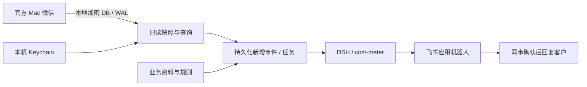

# WX Watcher

**普通微信本地消息 → DSH 回复建议 → 飞书内部群。**

macOS 本地消息助手：图形配置向导、菜单栏应用、独立微信凭据工具、只读消息 API，
以及可恢复的回复建议任务。建议送达内部飞书群，由同事确认后回复客户。

[English](README.en.md) · [安装](docs/INSTALL.md) · [微信取钥](docs/KEYTOOL.md) ·
[DSH](docs/DSH.md) · [飞书](docs/FEISHU.md) · [运维](docs/OPERATIONS.md) ·
[开发](docs/DEVELOPMENT.md) · [安全与隐私](SECURITY.md)

## 从哪里开始

| 目标 | 入口 |
| --- | --- |
| 第一次使用 | [安装与首次运行](docs/INSTALL.md) |
| 已有密钥 | 应用 → 微信凭据 → 验证并存入 Keychain |
| 第一次取钥 | [取钥向导及恢复](docs/KEYTOOL.md) |
| 使用现有模型渠道 | [DSH 与 cost-meter](docs/DSH.md) |
| 飞书接入 | [应用、权限、机器人与联调](docs/FEISHU.md) |
| 开发其他读取工具 | [只读 API 与凭据引用](docs/API.md) |

## 使用流程

1. 打开应用，检查运行环境。
2. 连接微信：导入已有密钥，或跟随独立取钥向导。
3. 选择准确的微信会话，配置业务资料和回复规则。
4. 连接 DSH，测试模型和 dsh-cost-meter。
5. 选择飞书接收群，试发并回读。
6. 开始监控，通过菜单栏管理后台运行。

首次扫描建立历史基线，后续处理新增事件。支持连续消息合并、持久化任务与调用上限。
模型失败或投递结果不确定时进入待核对状态，避免无限自动重试。

## 原理



日常读取不附加微信进程，不修改微信数据库，不控制微信界面，不向微信发送消息。
首次取钥是独立流程，可能临时重签名并通过 LLDB 附加微信，需要明确授权与恢复。
不能据此承诺零封号风险。[详细边界](docs/KEYTOOL.md)

读取与缓存发生在本机。选中的消息、必要上下文及业务资料发送到你配置的模型渠道；
建议发送到选定飞书群。项目没有自建云端消息服务。

## 支持范围

| 项目 | 当前范围 |
| --- | --- |
| 应用平台 | macOS 14+ / Apple Silicon；以实际兼容表为准 |
| 真实已验证组合 | macOS 27.0、微信 4.1.13（269630）、DSH NEXT 2.0.19-next |
| 自动取钥 | 仅放行已验证微信构建；其他环境可先导入密钥验证读取 |
| 数据库 | 当前 Mac 微信 SQLCipher4 布局，文本及部分引用/卡片文本 |
| 模型 | DSH 当前渠道；需满足桥接的宿主能力 |
| 用量 | dsh-cost-meter，金额为价格配置计算的估算 |
| 飞书 | 自建应用机器人，或已有 Lark CLI 配置 |
| 默认部署 | 单账号、单个指定会话、本机运行 |

未实测版本不因“能启动”就列为兼容。图片 OCR、语音转写、微信自动发送、
Windows/Linux 客户端和多租户服务不属于当前版本的支持范围。

## 从源码运行

安装 uv、SQLCipher 和适用的 Apple 开发者工具后：

```sh
git clone https://github.com/CalWade/wx-watcher.git
cd wx-watcher
uv sync --frozen
swift build --package-path native -c release
uv run wx-watcher desktop
```

[完整安装步骤](docs/INSTALL.md)。浏览器版与 Mac 应用使用同一界面；Mac 应用额外提供
原生文件选择和菜单栏。首次权限确认和微信登录仍由本人完成。

## 构建与检查

```sh
uv sync --frozen --group build
uv run python scripts/build_macos.py
uv run python scripts/verify.py
swift test --package-path native -c release
node --check integrations/dsh/index.mjs
uv run python scripts/check_release.py
```

应用产物位于 `dist/`，不依赖源码目录。正式 Developer ID 签名和公证需要维护者自己的
Apple 凭据；临时签名产物必须明确标注，不要求用户关闭系统安全保护。
自动测试使用合成数据，不需要个人账号或模型密钥。[验收标准](docs/DELIVERY.md)

## 数据与来源

默认私有目录：`~/Library/Application Support/WXWatcher`；独立环境可设置
`WX_WATCHER_HOME`。主密钥和飞书 App Secret 使用 macOS Keychain。
配置、缓存、任务、日志与备份不进入 Git 仓库。

本项目采用 [MIT](LICENSE)。取钥复用 GreenBubbles / wcdb-key-tool，WAL 快照和部分解析
来自 wechat-decrypt，数据库引擎使用 SQLCipher。[来源与修改记录](THIRD_PARTY.md)

[贡献](CONTRIBUTING.md) · [变更记录](CHANGELOG.md) · [安全报告](SECURITY.md)
