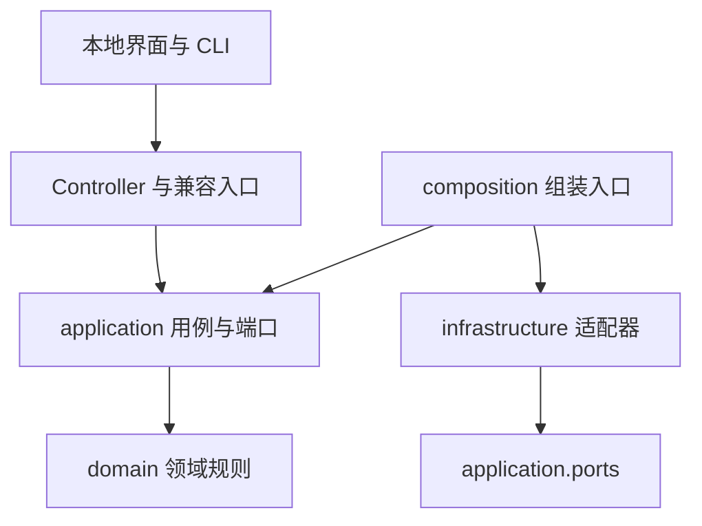

# 架构与模块边界

NoteBridge 使用轻量 DDD 分层与端口适配器设计。领域规则处理账号绑定、配置约束、回复格式与任务转换。应用层编排这些规则，通过接口访问数据库、凭据、Agent 和飞书。

## 依赖方向

领域层与应用层可以在内存端口上独立执行。架构测试检查导入方向、文件和进程操作，以及核心层中混入 DSH 协议字段的情况。

## 职责划分

| 边界 | 规则与用例 | 外部能力 |
| --- | --- | --- |
| 微信账号与凭据 | `domain/accounts.py`、`application/accounts.py`、`application/credentials.py` | 账号目录发现、Keychain、Swift 取钥与恢复 |
| 消息采集 | `application/collection.py` | `source.py` 的只读快照、SQLCipher、WAL，`store.py` 的事件和水位事务 |
| 回复工作流 | `domain/replies.py`、`domain/tasks.py`、`application/replies.py`、`application/tasks.py` | 任务仓库、资料检索、AgentGateway、DeliveryGateway |
| 接入与运行 | `domain/settings.py`、`application/settings.py`、`application/connections.py`、`application/runtime.py` | 配置文件、客户端准备、进程监督、登录启动 |
| 桌面交互 | `NoteBridgeDesktopDomain` 中的可信来源和桥接请求规则 | Swift AppKit/WebKit 窗口、选择器与权限帮助 |

`application/ports.py` 定义窄职责接口。时钟也作为端口传入，等待、合并窗口和预算可以通过确定性测试验证。

`composition.py` 负责选择实现。桌面设置和后台回复进程共享 Agent 注册表。生产入口默认组装实际适配器，测试入口传入内存端口或独立的本地协议服务。

## Agent 边界

业务代码仅接触 `AgentGateway` 和 `AgentJob`。任务使用通用的 `agent_provider`、`agent`、`usage`、`cost` 与 `session_ref` 字段。DSH 的协议、会话字段、费用插件和安装流程集中在 `infrastructure/agents/`。

当前提供 DSH 适配器与通用本机 HTTP 适配器。测试还通过内存实现直接运行回复用例。未来内嵌 Agent 可实现相同 Python 接口，并在组装入口注册；独立进程可实现统一 HTTP 协议。接入约定见 [Agent 扩展](AGENT_PROVIDERS.md)。

## 一致性与恢复

- 一次采集先读取全部分片，再提交消息和水位。分片失败保留原水位。
- 回复任务和事件游标在仓库事务中保存。合并队列、任务批次与预算计数也由仓库负责提交。
- 模型请求使用持久任务 ID。重启后的推理任务继续查询原任务，Agent 提交接口必须支持幂等。
- 持久任务绑定其 Agent 提供方。存在未完成任务时，设置入口拒绝更改提供方或连接配置。
- 投递前保存 `sending`。进程在投递期间退出后，任务进入 `delivery_review`，由操作者确认发送结果。
- 账号切换先验证凭据，再清空跨账号的会话和运行选项。

## 兼容策略

`controller.py`、`reply.py`、`collector.py` 保留原有调用入口。旧的 DSH 操作名在 Controller 边缘映射为通用操作。旧设置和任务在适配器中转换，既有凭据引用、任务 ID 和 Agent 会话关联继续保留。

数据库读取、取钥、进程监督等已有实现保留在原模块，由组装入口接入。新增业务规则应进入领域层或应用用例，具体 IO 实现应遵守端口接口。
