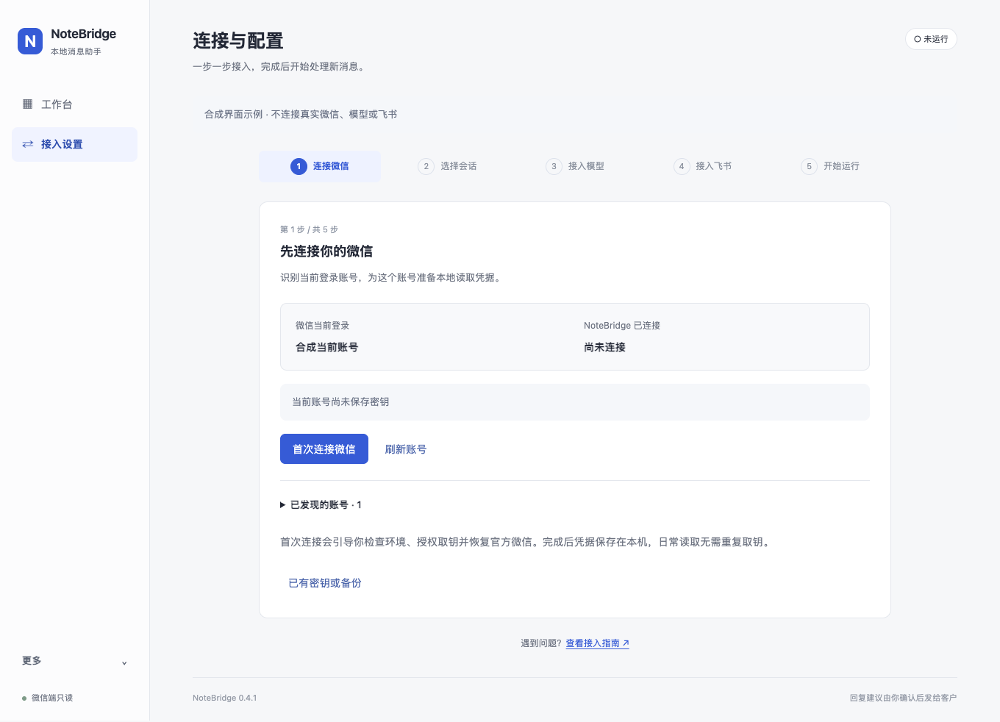
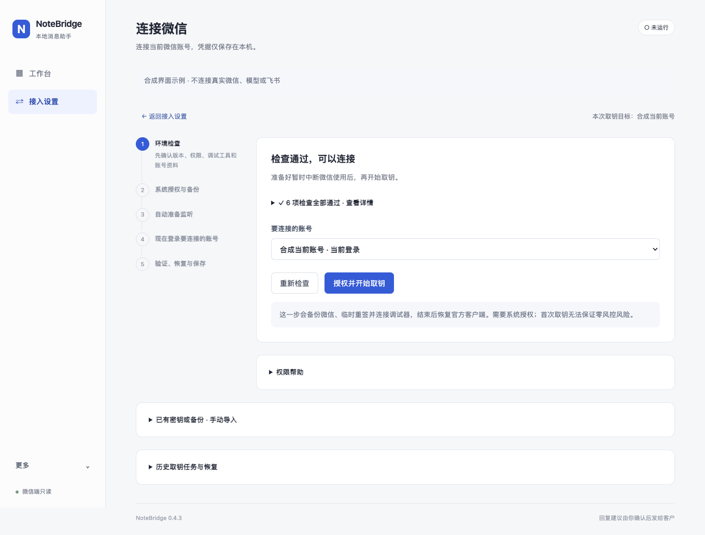
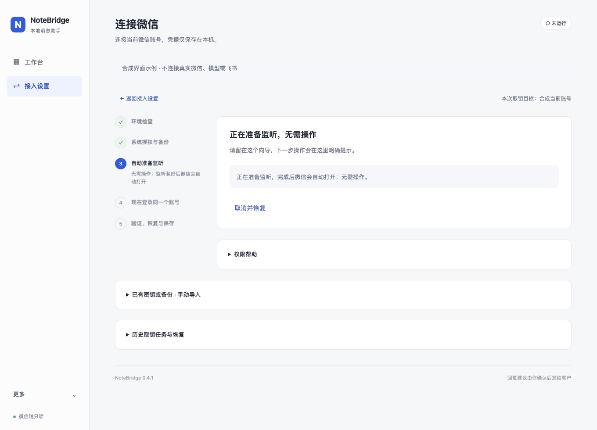
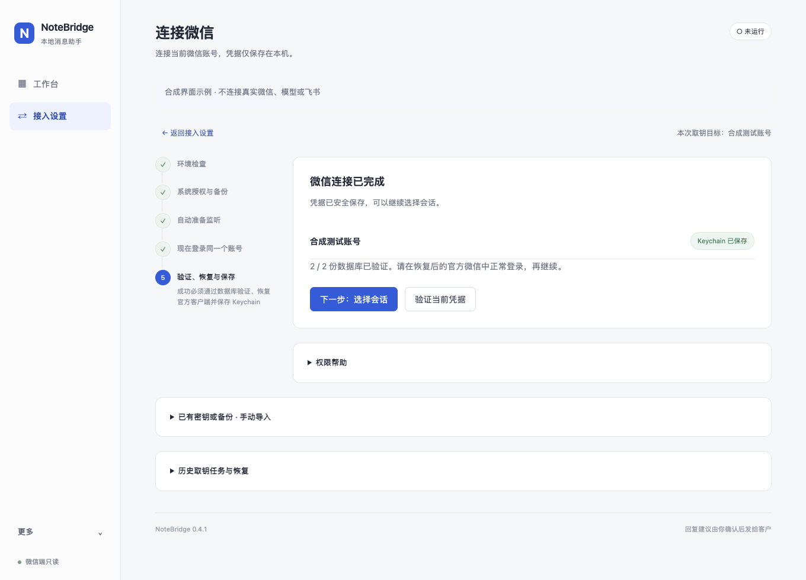
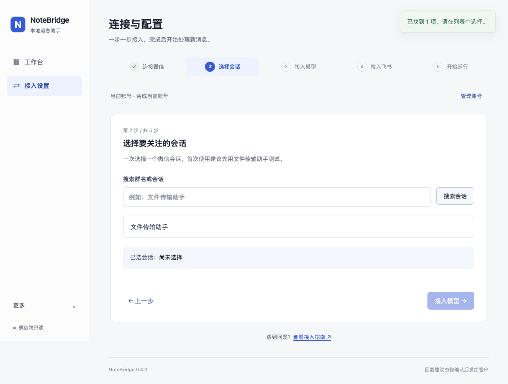
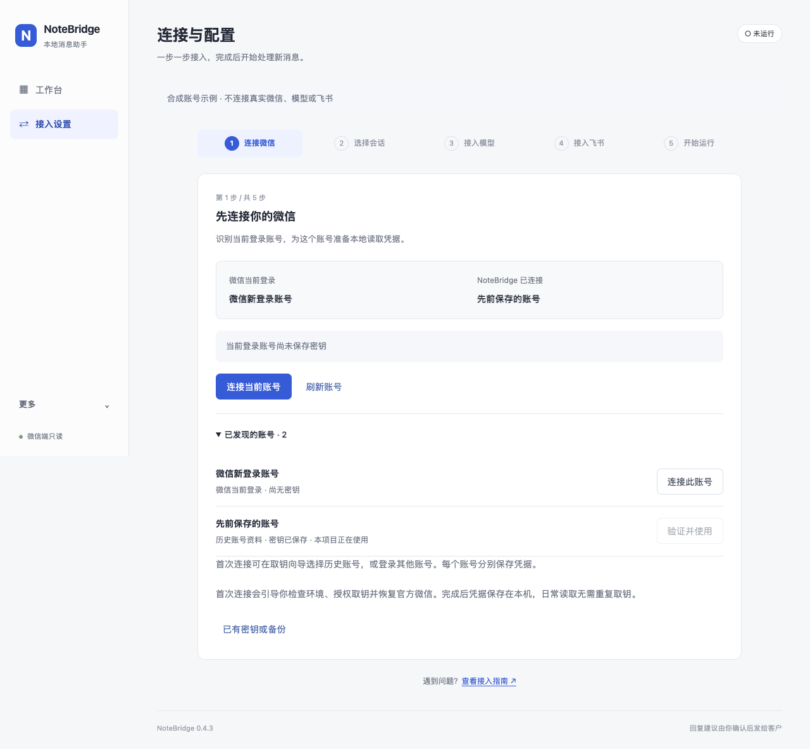

# 新机器从零使用：取钥 → 监听 → DSH → 飞书

本指南对应 **NoteBridge 0.4.2 预发布**。仓库仍叫 `wx-watcher`，下载和桌面应用叫 NoteBridge。
第一次使用只打开 **NoteBridge.app**，里面已包含取钥向导，不必同时安装或授权独立 Setup 应用。

下面的截图来自自动化测试中的**合成账号和模拟服务**，用于说明页面和操作顺序，
不含真实微信资料，也不代表新机器已经完成真机验收。
0.2.0 在维护者 Mac 的实际取钥及消息链路记录见 [验收记录](VALIDATION.md)；
0.4.2 的新机首装仍需按本文逐项验收。

## 0. 下载前先看兼容条件

| 项目 | 当前要求 | 缺少时怎么办 |
| --- | --- | --- |
| Mac | Apple Silicon；本次二进制包最低 macOS 27.0 | Intel 或较旧系统不能使用此安装包 |
| 自动取钥 | 已验证 macOS 27.0、微信 4.1.13（269630） | 其他组合会被拦截；可导入已有密钥验证读取，不保证兼容 |
| 微信 | 官方客户端装在 `/Applications/WeChat.app`，正常登录过本次账号 | 先安装、登录并生成本地消息资料 |
| 调试工具 | 实际可运行的 Apple LLDB；macOS 27 需要 LLDB 2000 或以上 | 安装适用 Xcode、打开并完成首次初始化，再检查 |
| DSH | Desktop 已启动，已有能回答问题的模型渠道 | 按 [DSH 教程](DSH.md)先配置一次 |
| 飞书 | 内部测试群、你自己的应用机器人 | 按 [飞书教程](FEISHU.md)创建并入群 |

应用包内含 Python 后端、原生凭据工具及数据库读取引擎，**普通使用不需要安装 Python、Node、uv 或 Homebrew**。
但它不包含微信、Xcode/LLDB、DSH 和飞书应用凭据。
当前已验证调试器为 Xcode 内 LLDB 2103，旧 LLDB 1600 曾导致附加失败。
不要把“装了命令行工具”当作兼容检查已经通过。

[Xcode 官方下载入口](https://developer.apple.com/xcode/resources/)提供 App Store、其他版本及开发工具下载；
其他下载需 Apple Account，Apple 说明不要求付费开发者计划。安装适用版本后先正常打开一次。
向导只检查实际工具，不会通过启动系统安装占位程序替你安装开发环境。

**本项目不提供旧版微信安装包或保证官方仍可下载某个历史构建。**
如果新机器只有未经验证的新版微信，自动取钥会停在兼容检查；不能承诺任意新 Mac、任意最新微信都能直接取钥。

## 1. 安装并打开主应用

1. 到 [GitHub Releases](https://github.com/CalWade/wx-watcher/releases)选择 0.4.2 及以后的对应预发布，
   下载 `NoteBridge-0.4.2-arm64.dmg` 或主应用 ZIP；不要把 `NoteBridge-Setup` ZIP 当作完整消息助手。
2. 核对发布页 `SHA256SUMS`，打开 DMG，将 **NoteBridge.app** 拖入「应用程序」，从那里打开。
3. 此包为 **ad-hoc 临时签名、未公证**。若 macOS 阻止打开，按系统对单个应用提供的确认流程操作；
   不要关闭 Gatekeeper、SIP 或全局安全设置。正式稳定分发尚需维护者 Developer ID 与公证。
4. 左侧只有「工作台」和「接入设置」。首次使用进入「接入设置」第 1 步，点击「首次连接微信」。
   业务资料、凭据维护和运行诊断放在左下角「更多」中。

已有密钥或本项目的加密备份时，点击次要入口；验证成功即可跳过调试取钥。
同一台机器的有效 Keychain 凭据可复用；另一台机器、另一个账号不能直接假定可复用。

## 2. 检查与准备，不先改微信

1. **先正常登录官方 Mac 微信**。如果这台 Mac 第一次登录，等消息资料生成，
   在「文件传输助手」发送 `NoteBridge 连接测试`。确认这台 Mac 能看到它。
2. 回到向导，点「检查并识别微信账号」。
3. 检查通过时显示检查摘要，展开可看全部结果；有问题的项直接显示。检查包含：官方微信、取钥兼容范围、调试工具、资料读取权限、本地消息资料、本次账号。
   单个活跃账号会自动选择；多个历史账号不会随意挑一个。需要手动处理时才展开高级选项。
4. 有阻塞项时，先处理对应项再点「重新检查」；此时开始按钮不可用。

检查是只读操作，不会退出微信、不重签、不附加调试器、不发起管理员任务。
“还没有本地数据库”与“系统拒绝读取”分别提示，不能把二者都当作需要反复授权。

### 系统权限怎样给

- **完整磁盘访问权限**：展开向导「权限帮助」，点按钮打开系统设置，为实际运行的 NoteBridge 开启。
  如果列表里没有，将权限帮助窗口中的应用图标直接拖入列表；也可点 `+` 选择
  `/Applications/NoteBridge.app`。开启后点权限帮助窗口中的「重新连接」，然后重新检查。
- **App 管理**：首次修改客户端前，macOS 还可能要求允许本应用管理微信。
  按系统提示确认；如果提示拒绝，点页面的「App 管理设置」处理，然后重试。
- **管理员授权**：只在你开始取钥时申请，由 macOS 的系统窗口处理。不要在本项目页面、聊天或终端脚本里填写系统密码。
- **Keychain**：保存和读取凭据时可能出现钥匙串确认，和上面几种权限不是同一件事。

只授权主 NoteBridge 即可完成本指南。单独使用 Setup 时，该应用需要它自己的权限。
临时签名更新可能使旧权限失效；已有密钥仍可复用，重新取钥不能解决应用权限问题。

## 3. 开始取钥：监听准备好后自动打开微信

检查通过后，点击「授权并开始取钥」，确认影响，并在 macOS 窗口完成管理员授权。
首次取钥会临时重签微信、附加 LLDB；这不是日常监听方式，也不能保证零风控。

| 向导显示 | 工具在做什么 | 你要做什么 |
| --- | --- | --- |
| 系统授权与备份 | 检查权限、备份并校验官方客户端、准备临时签名 | 在系统窗口授权；等待 |
| **自动准备监听** | 创建暂停的微信进程，在放行前安装监听；此时不显示登录窗口 | 无需操作，不必手动打开微信 |
| **现在可以登录微信** | 监听已安装，微信开始运行并显示登录窗口 | 扫码或点击登录，完成手机确认，进入所选账号 |
| 验证、恢复与保存 | 校验数据库、解除调试、恢复官方客户端，再次验证并写入 Keychain | 保持向导开启，等待最终结果 |

不再需要点击「我已停在登录页，准备监听」。微信由工具打开后可以直接登录；
若微信自动登录并触发密钥派生，向导可能直接进入验证阶段。
连接或监听安装失败时不会放行暂停进程；工具会清理并恢复官方客户端。
恢复后的官方微信可能再次出现登录页，此时请先看向导的最终结果，避免把失败后的恢复误认为取钥就绪。

整个准备与监听有截止时间。需要结束时点「取消并恢复」，等待恢复结果，不能立即强杀。
如意外退出，重新打开同一应用，在「历史取钥任务与恢复」处理未完成任务。

## 4. 判断取钥是否真的成功

成功应同时满足：

- 本次发现的数据库全部验证通过，页面显示具体数量。
- 官方微信已恢复，调试器已退出。
- 「已连接账号」显示 **Keychain 已保存**，而非仅有“捕获到候选”。
- 出现「下一步：选择会话」。

恢复过程会重新打开官方客户端。请在恢复后的微信里正常登录；这次不需要再次取钥。
点击「下一步：选择会话」。页面不会展示或要求你复制主密钥。
建议在「已有密钥或备份 · 手动导入」下载一份加密凭据备份，使用至少 12 字符的独立口令并分开保管。

## 5. 从能读到能运行

接入设置每次只显示当前一步，上方步骤条可返回已开放的步骤。保存或选择后无需再关闭成功弹窗。

1. **第 2 步 · 选择会话**：搜索并选择 **文件传输助手**。确认「已选会话」后点下一步。
   初次启动会建立基线，旧消息不会自动转发。
2. **第 3 步 · 接入模型**：先确认 DSH 中的模型能正常回答问题，再点「连接 DSH 与费用插件」。
   复用现有渠道和费用插件，缺少插件时由已安装 Desktop 的官方入口补齐。
   「测试模型与记账」会调用一次模型；结果应有工具数 0 和费用记录。详见 [DSH 步骤](DSH.md)。
3. **第 4 步 · 接入飞书**：有现成 Lark CLI 配置就复用；新机器可选「使用自建飞书应用」，
   填写 App ID/Secret 并安全保存。选项切换后表单立即显示。
   按 [飞书步骤](FEISHU.md)创建应用、启用机器人、导入权限、发布并加入**内部测试群**，
   再点「获取机器人所在群」，选择接收群。需要时展开「单独测试飞书连接」。
4. **第 5 步 · 开始运行**：确认会话、接收群及是否自动投递。仅保存草稿时，业务建议留在本机。
   登录启动和恢复监控选项在「启动方式」中。需要业务资料可从左下角「更多 → 业务资料与规则」补充。
5. 点击「测试并开始运行」。此按钮真实调用一次模型，并向**选定飞书群**发送一条连通性测试消息；
   所有检查通过后进入工作台。即使业务建议只保存本地草稿，连通性测试本身仍会发送。

主应用关闭窗口后保留在菜单栏；从菜单选择退出才停止它拥有的后台服务。
运行时保持 Mac 不休眠、微信正常登录、DSH 开启并联网。

## 6. 用一条“新增问题”验收

开启监控后，再在 Mac 的文件传输助手发送一句：

> 验收测试：培训资料什么时候发给我们？

1. 在 NoteBridge「工作台 → 最近回复建议 → 查看全部」看到本次新增任务和原问题。
2. 能看到建议、理由和待确认事项；缺少业务资料时不应编造时间。
3. 启用飞书自动投递时，在所选内部测试群确认这条建议及发送身份。
4. 在 DSH 费用记录中核对本次会话，不把“未知价格”当免费。
5. 暂停监控再开启，确认游标和配置保留，不把历史消息再广播一遍。

数字串或无需回复的文本可能按策略跳过模型，用明确问题做完整链路测试。
先看到安装连通性消息，不等于新增微信消息链路已经验收。
采集耗时与模型、投递耗时分别计算；不能承诺每次完整链路都在 10 秒以内。

完成后，再把监听对象换成获准处理的客户群；回复建议发内部飞书群，客户回复由同事决定并发送。

## 7. 已有配置，但微信换了另一个账号

在「接入设置」第 1 步管理账号。后续步骤点击「管理账号」可返回；账号不匹配时会回到连接步骤：

- **微信当前登录**：从当前用户的微信进程实际打开的消息数据库识别；无法唯一确认时会明确说明，不能把历史目录当作当前登录。
- **NoteBridge 已连接**：当前配置关联的已保存账号，与微信登录状态分别展示。
- 「已发现的账号」列出当前账号、历史账号，以及各自是否保存了密钥。这里只显示保存状态，不会为查看列表读取或展示密钥。

当前账号**没有密钥**时，点「连接当前账号」。向导直接选中当前账号作为目标，
仍需按提示检查、授权和取钥。旧账号的密钥与任务记录保留；新账号不能直接使用旧账号密钥。
当前取钥目标未完成时，不会拿旧账号的已保存状态充当本次成功结果，也不能导出成“本次账号备份”。

当前账号**已有密钥**时，点「验证并切换到当前账号」。工具先确认登录账号匹配，并重新验证它自己的数据库；
验证失败则保持原配置。切换成功后清空旧微信会话选择，关闭自动投递和自动恢复监控，
要求重新选择会话、确认飞书接收群后再启用。已有凭据、历史任务和飞书连接资料继续保留。

如果正在监控，页面先询问是否暂停；不会自动登录或退出微信。
要使用历史账号，先在官方微信中正常登录那个账号，再点「刷新账号」。

账号不匹配或无法确认时，不允许开始监控、读取会话列表或进行全链路测试。
运行中每 5 秒检查一次账号身份；检测到变化或无法确认时暂停本应用的监控，并显示原因，
确认账号与配置后由用户重新启动。这个检查间隔不等于对所有微信切换事件的即时拦截保证。

## 8. 卡住时按阶段处理

| 现象 | 下一步 |
| --- | --- |
| 首页只有旧版 watcher 页面，没有首次连接入口 | 确认下载并打开的是 0.4.2 及以后的 NoteBridge 主应用 |
| 没有账号 / 没有本地数据库 | 先在本 Mac 正常登录、发送连接测试，再检查；不要立刻重新取钥 |
| 系统或微信版本未验证 | 停在检查页，记录版本；不通过修改版本号或关闭保护绕过 |
| LLDB 不兼容 | 安装适用 Xcode、初始化，再检查；反复登录不能修好调试器 |
| 点击开始后提示 App 管理拒绝 | 允许实际运行应用后重试；工具应在退出和修改微信前停下 |
| 旧版刚开始安装监听就失败 | 更新到 0.4.2；0.4.1 存在启动器退出导致暂停进程消失的问题，延长等待或反复扫码无效 |
| 自动准备监听 | 等待工具完成；微信自动打开后登录即可 |
| 微信登录无响应 | 看当前阶段；先取消并恢复，避免连续退出、关闭、重开混在一起 |
| 已进聊天页但仍未验证 | 读明确错误；账号目录不一致时先恢复并重新选择账号 |
| 恢复未完成 | 保留任务目录和备份，使用恢复入口，不新开取钥任务 |
| Keychain 拒绝 | 处理钥匙串权限；不要重取密钥来解决 |
| 微信有新消息，飞书没有 | 看任务是已跳过、生成中、草稿还是待核对；再分别检查 DSH 与飞书 |

报告问题用 [Issue 模板](../.github/ISSUE_TEMPLATE/bug_report.yml)，提供版本、阶段、脱敏错误类别。
不要上传密钥、App Secret、真实聊天、数据库、整个应用数据目录或未经检查的诊断日志。
